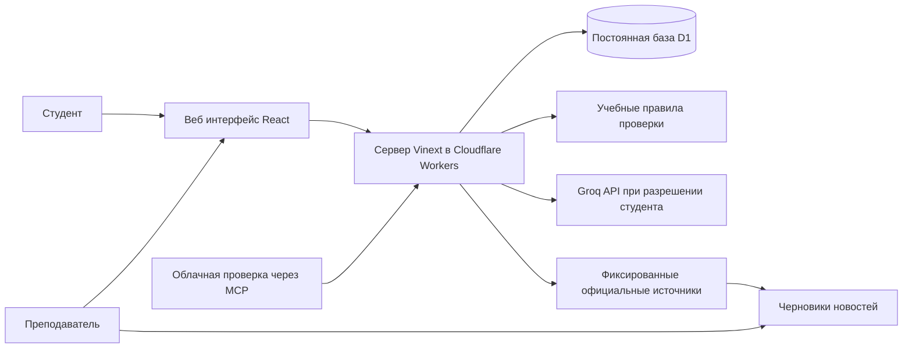

# УМНИК Практикум

Веб-тренажер подготовки исследовательской заявки для дисциплины «Учебный научный семинар». Восемь разделов соответствуют рабочей тетради семинара 1. Автор учебных материалов — Никитин Петр Владимирович, к.пед.н., доцент, доцент кафедры искусственного интеллекта Финансового университета при Правительстве Российской Федерации.

Сайт: https://umnik-fu-simulator.sappy-lark-0662.chatgpt.site

## Возможности

- Индивидуальные учетные записи, обязательная смена временного пароля, роли `student` и `admin` в БД.
- Формы и редактируемые таблицы всех восьми разделов тетради, подсказки и ссылки на страницы пособия.
- Автоматическое сохранение после паузы ввода, отдельная кнопка сохранения, контроль конфликтов версий.
- История сохраненных изменений с предыдущими и новыми значениями, восстановление содержимого новой версией.
- Учебная проверка допуска, содержания и эксперимента. Дополнительные рекомендации внешней LLM по явному разрешению студента.
- Панель преподавателя: поиск, доступ, сброс временного пароля, просмотр заявки и истории, комментарии к конкретной версии.
- Сводка студентов, проверки, изменения, аудит и комментарии в CSV; учебный архив в JSON; печать заявки средствами браузера.
- Редактор новостей, источники, даты события и проверки, черновики обнаруженных изменений официальных страниц.

Тренажер не подает заявку в Фонд-М и не принимает решение о выдаче гранта. Закрытая очередь 1 2026 используется как учебный пример. Будущие сроки нельзя переносить из старого положения. Цифры в примерах являются плановыми целями.

## Архитектура



Сервер и постоянная БД размещаются через Sites. Это полноценная серверная запись, а не localStorage. D1 — управляемая SQLite-совместимая база; миграции Drizzle находятся в `drizzle/`. Девять таблиц: `users`, `sessions`, `revisions`, `evaluations`, `reviews`, `news`, `audit`, `settings`, `limits`.

Роль администратора является ролью приложения в таблице `users`. Студенты не получают SQL учетных данных. Каждый серверный запрос проверяет активную сессию, обязательную смену пароля, роль и владельца данных. Уникальный индекс `(user_id, version)` и атомарный batch предотвращают потерю параллельных правок. Источником заявки служит последняя неизменяемая сохраненная версия.

Пароли хранятся как PBKDF2 SHA-256 с индивидуальной солью и 100 000 итераций. Сессия хранит только хеш случайного токена; cookie HttpOnly, SameSite Strict, Secure на HTTPS, срок 8 часов. Действуют ограничения запросов. POST проверяет Origin; ввод проверяется на сервере; SQL параметризован. Смена или сброс пароля завершает предыдущие сессии. Нет открытой регистрации и общих демонстрационных учетных записей в рабочей БД.

Список студентов и файл начальных паролей **не публикуются в этом репозитории**. Образцы тестов содержат только вымышленные локальные учетные записи. Импорт выполняется одноразово в защищенный `/api/bootstrap` по серверному секрету; после импорта удалите `BOOTSTRAP_TOKEN`. Файл с паролями предназначен преподавателю; каждому студенту выдаются только его данные.

## Подключение LLM

В защищенных переменных хостинга задайте `GROQ_API_KEY` как секрет и при необходимости `GROQ_MODEL`. Примените новую ревизию окружения публикацией сохраненной версии сайта. По умолчанию модель `openai/gpt-oss-120b`; ее доступность проверьте в своем аккаунте. Бесплатный план имеет квоты, не обещает неограниченного использования. Приложение не выполняет платный автоматический переход и при HTTP 429, ошибке или отсутствии ключа сохраняет проверку по тетради. На рабочем сайте Groq подключен 11 октября 2026 года; ключ `UMNIK-FU-server` действует до 9 января 2027 года. Перед этой датой владелец создает новый ключ и обновляет секрет хостинга.

Внешняя LLM выключена, пока не настроен ключ. Студент дополнительно разрешает отправку содержательной части отдельным флажком. В запрос не включаются поля учетной записи, ФИО, пароли, консультант, группа, паспортные сведения и приложения. Применяется ограниченный список проектных полей и маскирование очевидных идентификаторов. Это не гарантирует удаление любой персональной информации из произвольного текста: студент должен исключить ее сам.

Модель возвращает рекомендации на русском языке с идентификатором поля и точной цитатой из переданного текста. Сервер отбрасывает неизвестные поля, неподтвержденные цитаты и очевидные обещания гранта. Запрос запрещает выполнять инструкции внутри заявки, выдумывать правила, сроки, достижения и вероятность победы. Рекомендации остаются мнением модели и требуют проверки преподавателем. Учебные баллы 0–10 по трем группам — эвристика содержания полей, а не официальные баллы экспертизы. Условие «99% отказов с первой попытки» не имитируется случайной генерацией: незаполненные и слабые заявки получают содержательные замечания.

Официальные сведения об API: [модели](https://console.groq.com/docs/models), [бесплатные квоты и ограничения](https://console.groq.com/docs/rate-limits), [обработка данных](https://console.groq.com/docs/your-data). Доступность сервиса зависит от аккаунта и условий провайдера. Перед подключением проверьте настройки хранения данных.

## Новости и автоматическое обновление

Кнопка администратора «Проверить источники» проверяет две фиксированные страницы Фонда и резервный RSS регионального представительства ФСИ Саратовской области: [лента](https://fsimp.ru/rss.xml), [статус представительства](https://fsimp.ru/region). RSS отбирается по УМНИК; разрешены ссылки только на новости этого домена. Черновики содержат короткое описание и ссылку, с пометкой региона и датой публикации по московскому календарю. Дата события остается пустой до сверки. Региональные условия не переносятся автоматически на студентов в Москве.

Стабильные идентификаторы предотвращают повторные черновики при повторных и одновременных проверках. Изменение конкретной публикации создает отдельный черновик. Состояние каждого источника и число новых черновиков сохраняются. HTTP 403 отображается как недоступность, а не отсутствие новостей. RSS содержит последние 100 публикаций: это ограниченная лента, а не полный архив или гарантия охвата всех каналов Фонда. Новые сообщения публикует преподаватель после сверки. В журнале сохраняются прежние и новые значения текста, даты, ссылки и статуса.

Единственное новое заранее проверенное сообщение — краткая сводка [итогов УМНИК-2026 очереди 1](https://fsimp.ru/news/197), с датой публикации представительства 14 августа 2026 года. Оно добавляется идемпотентно; правки или архивация преподавателем не перезаписываются синхронизацией. Следующий прием не считается подтвержденным.

Публикация сообщения не изменяет автоматически учебный ruleset. Для нового конкурса необходимо сверить положение, обновить `lib/workbook.ts` и `lib/evaluation.ts`, обозначить новую редакцию, выполнить проверки и повторную публикацию. История старых оценок сохраняет свой ruleset. Архивные даты отделены от будущих и учебных.

Для проверки при закрытом сайте предусмотрен MCP `/mcp` с двумя инструментами: `check_competition_sources` и `read_news_status`. Администратор входит через ChatGPT в панели сайта, нажимает «Привязать облачное обновление», подключает созданный Sites плагин и настраивает расписание, например ежедневно в 09:00 Europe/Moscow. Только привязанный Site-scoped ID владельца может запускать эти инструменты; они не читают студенческие данные. **До завершения привязки и проверки облачного вызова автоматическое расписание не считается включенным.**

Альтернативный HTTP writer `/api/news/sync` принимает только `Authorization: Bearer NEWS_SYNC_TOKEN`. Для собственного cron нужно настроить секрет в серверной среде и планировщике. Ключи не помещаются в URL, Git, журналы или пользовательские задания.

## Вариант Yandex Cloud

Предоставленная ссылка указывает на [проект DataSphere](https://datasphere.yandex.cloud/communities/bt1q675kmvon19scqcr3/projects/bt1npr1cje7o52d8gfl5). Авторизованный доступ и ресурсы этого проекта не проверены. Никакие платные ресурсы Yandex Cloud автоматически не создавались.

По [документации DataSphere](https://yandex.cloud/ru/docs/datasphere/concepts/project) проект является рабочим пространством вычислений, хранилищем ресурсов и средой JupyterLab. Его можно использовать для испытания локальной открытой LLM и экспериментов студентов. Для постоянно доступного многопользовательского приложения предпочтительнее отдельный backend и управляемая БД.

Вариант переноса: веб интерфейс и API в Yandex Serverless Containers или VM; PostgreSQL в Managed Service for PostgreSQL; секреты в Lockbox; TLS перед backend; резервные копии БД по правилам сервиса. Для связи из Workers с Yandex БД потребуется защищенный HTTPS API: сырое TCP подключение Workers не поддерживается. Объекты и ограничения текущей схемы переносятся миграцией; SQLite SQL не запускается в PostgreSQL без адаптации. Этот репозиторий содержит **реализованный D1 вариант**, а не готовый PostgreSQL адаптер. Стоимость и доступность ресурсов проверяются перед переносом; DataSphere не объявляется бесплатным постоянным сервером.

## Работа преподавателя

1. Откройте сайт. Войдите как `nikitin-admin` с временным паролем из закрытого файла и смените его.
2. Выдайте каждому студенту его строку учетных данных. Общий файл группе не отправляйте.
3. Студенты заполняют восемь разделов, используют примеры как заготовки и подтверждают свои факты.
4. Проверка сохраняет результат конкретной версии. После исправлений нужна новая попытка; старая оценка помечается устаревшей.
5. Откройте заявку в панели, проверьте источники, новизну и реализуемость; оставьте комментарий к версии.
6. Выгрузите нужный отчет. CSV использует UTF-8 BOM и разделитель `;`; даты журналов хранятся ISO UTC, интерфейс показывает Москву. Период событий и проверок включает обе выбранные даты целиком по Москве: от 00:00 первой даты до 00:00 дня после последней. Несуществующие даты отклоняются. К сводке студентов и полному архиву период не применяется.
7. «Учебный архив JSON» содержит учебные записи, ФИО и логины без хешей паролей и сессий. Он не заменяет резервную копию БД и не импортируется автоматически. Храните выгрузки с ограниченным доступом.

Изменения фиксируются после сохранения, а не после каждого нажатия клавиши. При закрытии вкладки до сохранения возможна потеря локального текста; интерфейс предупреждает о несохраненных правках. Если возник конфликт, сохраните свой текст отдельно и загрузите актуальную версию кнопкой «Обновить из базы».

## Разработка

Node 22.13 или новее, pnpm 11.25.0. Поддерживаются Windows и Linux. Стандартный Vinext starter и интеграция Sites сохранены.

```sh
pnpm install --frozen-lockfile
pnpm exec drizzle-kit generate
pnpm build
node --import ./scripts/sites-env.mjs ./node_modules/wrangler/bin/wrangler.js d1 execute DB --local --config dist/server/wrangler.json --persist-to .wrangler/state --file drizzle/0000_graceful_marten_broadcloak.sql
pnpm dev
```

Не повторяйте уже примененную локальную миграцию. Local D1 и рабочая D1 — разные базы. Тестовые учетные записи нельзя импортировать в рабочую БД. Для собственного нового Sites deployment удалите чужой `project_id` из `.openai/hosting.json` и зарегистрируйте свой сайт. Для поддержки текущего сайта сохраняйте его ID.

`tests/evaluation.test.ts` проверяет правила тетради; `tests/news-calendar.test.ts` — фильтрацию RSS, безопасные ссылки, даты и границы московских суток. Запуск: `node scripts/test-rules.mjs`. `tests/api-smoke.py` — интеграционные проверки на отдельной локальной БД с тремя вымышленными учетными записями. Они не запускаются против рабочего сайта. SQL для их настройки не входит в исходники с реальными студентами.

Учебные материалы: `public/materials/`. Исходники форм: `lib/workbook.ts`; проверка: `lib/evaluation.ts`; сервер: `app/api/[...path]/route.ts`; интерфейс: `app/simulator.tsx`.
